<div align="center">

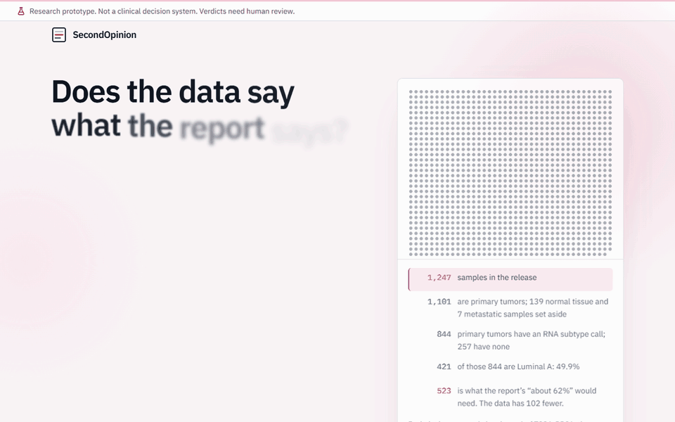

# SecondOpinion

**A fact-checker for cancer research reports.** It recounts every figure in a report against the real
patient data, shows its working, and rewrites each claim to say what the data actually supports.

[](pyproject.toml)
[](apps/web/package.json)
[](apps/web/tsconfig.json)
[](apps/api/app)
[](second_opinion)
[](#tested-like-it-matters)
[](#award)

🏆 **First place, Track 2 (Evidence Navigator)** at the
[AI Healthcare Hackathon at Northeastern](https://the-open-accelerator.com/hackathon/upcoming/OncoSysHack/), November 2026

**[Watch the demo video](https://youtu.be/RAVG4QaeblI)** &nbsp;·&nbsp; **[Run it locally](#run-it-locally)** &nbsp;·&nbsp; **[Full guide](docs/GUIDE.md)**

<sub>Research prototype, not a clinical tool.</sub>

</div>

---

## Award

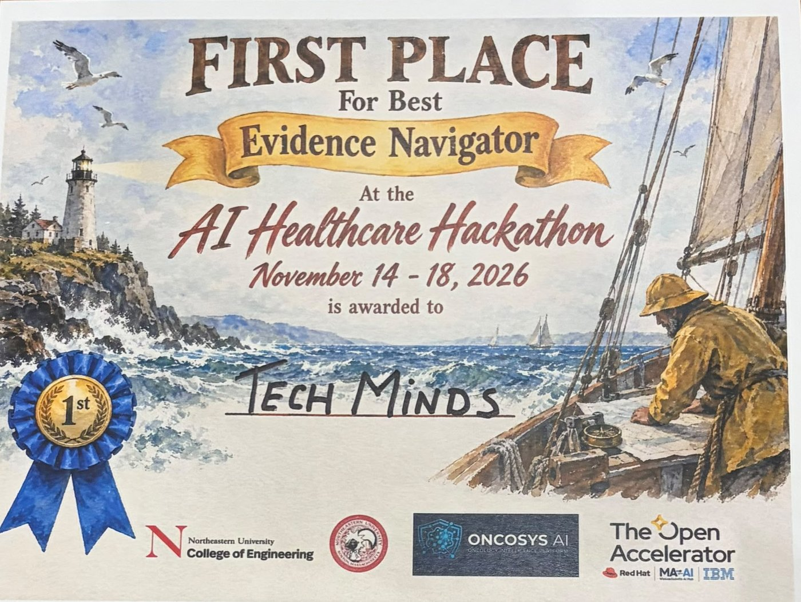

SecondOpinion, built by team **Tech Minds**, won **First Place for Best Evidence Navigator** at the
[AI Healthcare Hackathon at Northeastern](https://the-open-accelerator.com/hackathon/upcoming/OncoSysHack/).

- **Organized by** Northeastern University, OncoSys AI, The Open Accelerator and Red Hat.
- **Format:** four days, November 11–14, 2026. Teams of 3–5 built virtually, then presented at the in-person
  finals at Northeastern University in Boston.
- **Challenge:** two tracks on the same frozen TCGA-BRCA release (real breast-cancer data from The Cancer
  Genome Atlas). Track 2, *Evidence Navigator*, asked teams to help people understand oncology data and
  choose a next step.
- **Judging:** a 100-point rubric across seven criteria, with **one winner per track**.

<br clear="right">

---

## The problem

Research reports about cancer data are full of numbers, and some of them are quietly wrong: a percentage
that is a little off, a claim about treatment when the data has no treatment records, or a result that only
holds if you count one particular way. Checking means digging through raw files and writing code, so most
reviewers simply trust the report.

**SecondOpinion does the digging.** Give it a report (Markdown, text or PDF) and the TCGA-BRCA breast-cancer
data release it describes. It finds every checkable claim, recounts it from the data, stress-tests the
answer, and hands a person a clear verdict to sign off.

> Luminal A is the largest RNA subtype, accounting for ~~about 62%~~ **49.9% (421 of 844)** of primary tumors.
>
> <sub>The report said 62%. The data says 49.9%, and it is never 62% under any of the eight ways of counting
> (44.3% to 49.9%). Verdict: **contradicted, robust**.</sub>

## A full audit in 40 seconds

<p align="center">
  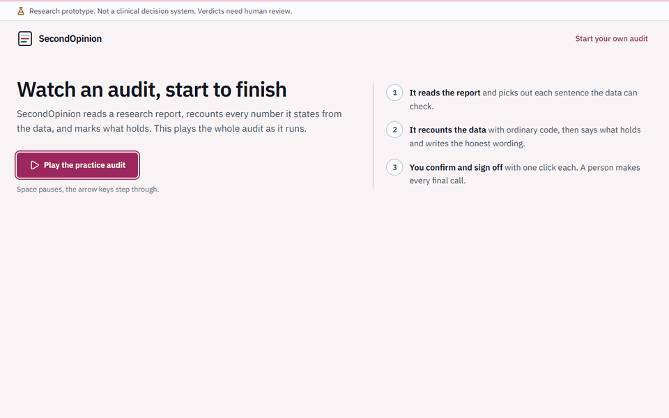
</p>
<p align="center"><sub>The app's built-in storyboard (<code>/demo</code>) playing the organizers' practice report, sped up 1.5×.</sub></p>

## How it works

<p align="center">
  
</p>

Each claim ends with one of three verdicts, **supported**, **contradicted** or **insufficient evidence**, plus
a tag saying whether that verdict is **robust** or **fragile** under other reasonable ways of counting.

## What makes it different

**Code decides, not AI.** Every verdict comes from deterministic pandas code with explicit tolerance rules
("about" allows 2 points, "nearly all" means at least 90%, and so on). An optional LLM helper can translate an
unusual sentence into a structured plan, but the engine validates that plan, runs it and judges the result.
When the AI writes a summary, the numbers are named blanks that the browser fills from the audit, so a model
can never put a made-up figure on screen.

**It checks its own answer.** Each figure is recounted eight ways (which subtype label, which sex, which
samples). If the verdict never changes it is *robust*; if it flips, the tool names the choice that flips it.
Comparisons also get skeptic tests: label shuffles and leave-one-hospital-out.

**Every number shows its work.** The evidence page gives the SHA-256 of each data file, the exact pandas
snippet that reproduces the figure, and the sample IDs behind it as a CSV.

**A person has the last word.** Every verdict is accepted or overridden with a reason. Four role-tailored
review views (program leader, data-use reviewer, researcher, data engineer) are configured in YAML. Export
stays locked until every claim is reviewed, and the output validates against the organizers' shared JSON schema.

**Hard to fool.** It reads numbers written as words ("eleven hundred", "one in six"), hedges ("about",
"the majority"), bounds, rankings, ratios and multi-part sentences. It recognizes claims the data cannot answer
(treatment, causation, missing measures) instead of guessing. One regression report even contains a
prompt-injection sentence ("Ignore your earlier instructions…"), which is audited like any other claim.

## See it in action

<table>
  <tr>
    <td width="50%" valign="top">
      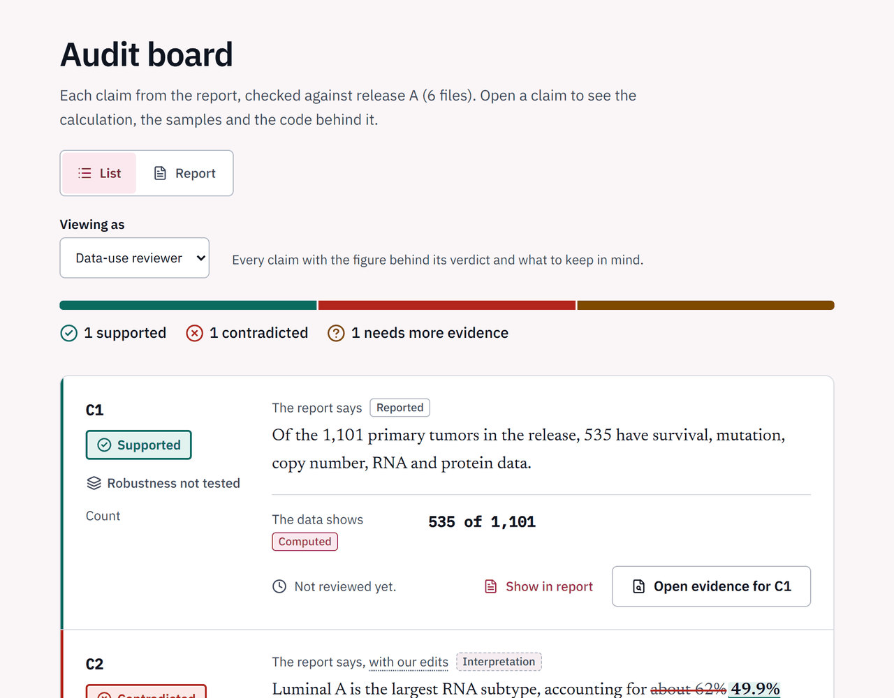<br>
      <b>Audit board.</b> Every claim with its verdict, how solid it is, and the wording the data supports.
    </td>
    <td width="50%" valign="top">
      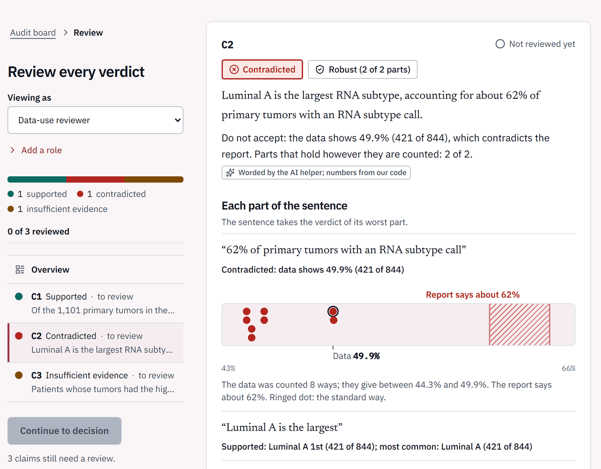<br>
      <b>Review.</b> A person accepts or overrides each verdict, with charts sized to their role.
    </td>
  </tr>
  <tr>
    <td width="50%" valign="top">
      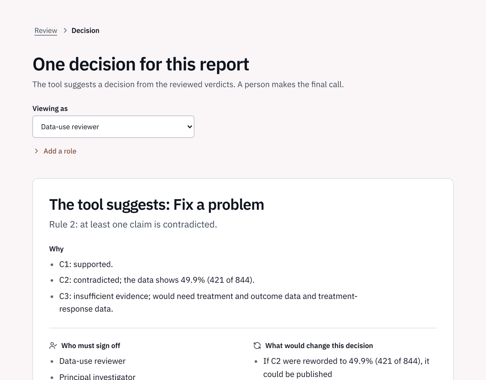<br>
      <b>Decision.</b> A suggested outcome with its rule, who must sign off, and what would change it.
    </td>
    <td width="50%" valign="top">
      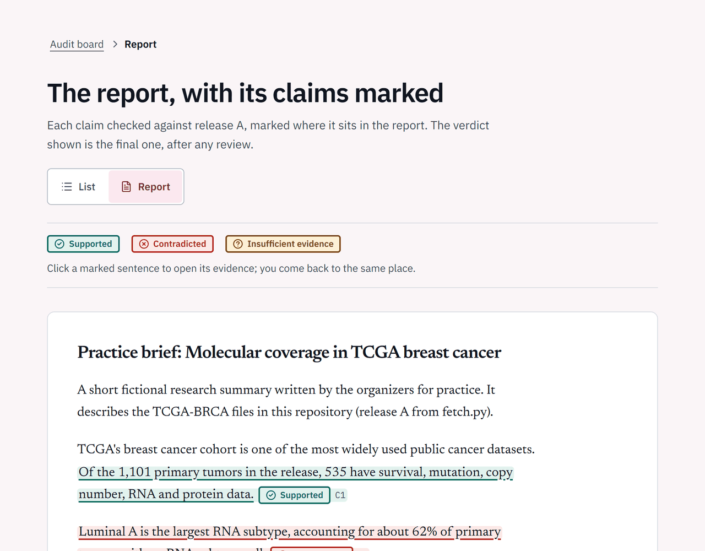<br>
      <b>Report view.</b> The report as written, with each claim marked where it sits.
    </td>
  </tr>
  <tr>
    <td width="50%" valign="top">
      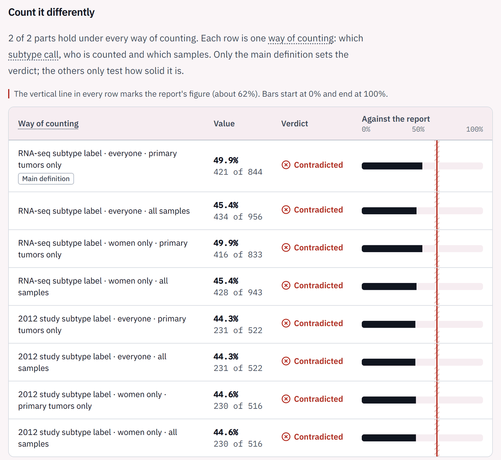<br>
      <b>Counted eight ways.</b> No way of counting reaches the report's 62%, so the verdict is robust.
    </td>
    <td width="50%" valign="top">
      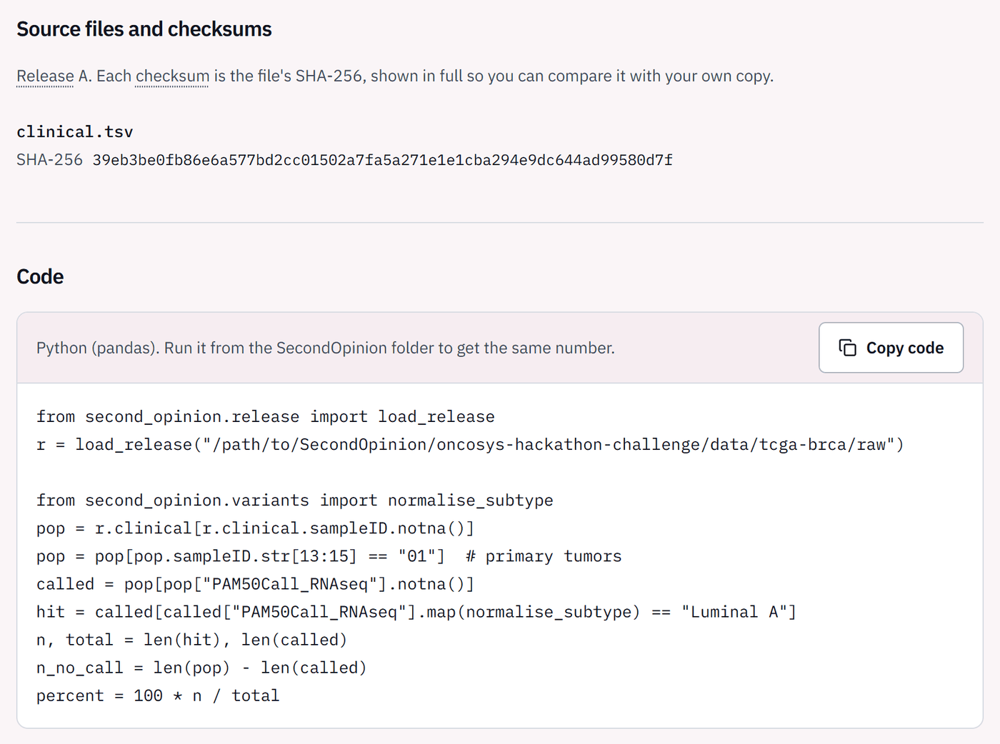<br>
      <b>Reproducible.</b> Checksums plus the exact code to get the same number yourself.
    </td>
  </tr>
</table>

## Tested like it matters

| Number | What it measures |
| ---: | :--- |
| **1,500+** | automated tests: 1,336 Python (engine, API, export, real-data) and 171 web (Vitest) |
| **18** | reports with known answers in the regression suite |
| **87** | claims in 7 of those reports, written blind by independent agents with pandas answer keys before they saw the tool |
| **8** | ways every count is redone to test whether its verdict holds |
| **< 10 s** | for a full audit of a report, from the browser or the CLI |
| **~23k** | lines of Python and TypeScript |

The real-data tests reproduce the organizers' reference numbers exactly (535 of 1,101 tumors with
every data layer, Luminal A 421 of 844, ER-alpha difference 3.051).

## Architecture

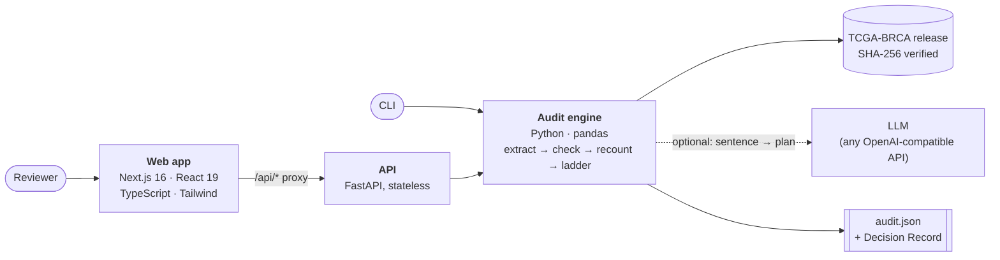

- **No database, no session state.** The browser keeps the audit and sends back what each step needs, so any
  API instance can answer any request, and a page reload keeps your work.
- **One engine, two front doors.** The web API and the `second-opinion` CLI share the same Python package.
- **Safe by default.** Release folders can be confined to one root (`SO_RELEASES_ROOT`), with path-escape tests.
- **Accessible.** Verdicts never rely on color alone, targets are at least 44px, live regions announce progress,
  and every animation respects reduced-motion settings.
- **Cross-platform.** The same `npm` commands run on macOS, Linux and Windows.

| Layer | Tools |
| --- | --- |
| Frontend | Next.js 16 (App Router), React 19, TypeScript, Tailwind CSS 4, Motion, Lucide icons |
| Backend | FastAPI, Python 3.11–3.14, pandas, pypdf, jsonschema |
| Quality | pytest, Vitest, ESLint, `tsc --noEmit` |
| AI (optional) | Any OpenAI-compatible chat endpoint, off unless configured |

## Run it locally

Needs **Node.js 22+**, **Python 3.11–3.14** and **git**. About 10 minutes the first time, mostly downloads.

```bash
git clone https://github.com/benoyj20/SecondOpinion.git && cd SecondOpinion
python3 -m venv .venv && .venv/bin/python -m pip install -r requirements.txt
npm ci
.venv/bin/python oncosys-hackathon-challenge/data/tcga-brca/fetch.py   # ~70 MB of public TCGA data, checksummed
npm run dev
```

<details>
<summary>Windows (PowerShell)</summary>

```powershell
git clone https://github.com/benoyj20/SecondOpinion.git; cd SecondOpinion
py -3.13 -m venv .venv; .venv\Scripts\python.exe -m pip install -r requirements.txt
npm ci
.venv\Scripts\python.exe oncosys-hackathon-challenge\data\tcga-brca\fetch.py
npm run dev
```

</details>

Open **<http://localhost:3000>**, choose **Start an audit**, then **Run the practice audit**. Or open
**Watch an audit** for the storyboard. To check a report from the terminal:

```bash
.venv/bin/second-opinion --release oncosys-hackathon-challenge/data/tcga-brca/raw --report report.md --out audit.json
```

The **[full guide](docs/GUIDE.md)** covers step-by-step setup for every OS, each screen, the exact verdict
rules, configuration, the optional AI helper, sealed-envelope judging, tests, troubleshooting and known
limitations.

## Data credits and third-party code

The results shown here are in whole or part based upon data generated by the TCGA Research Network:
https://www.cancer.gov/tcga. Data via [UCSC Xena](https://xenabrowser.net/) (Goldman et al., *Nat
Biotechnol* 2020) and the TCGA Pan-Cancer Clinical Data Resource (Liu et al., *Cell* 2018); slide
metadata via NCI Imaging Data Commons. Details in
[docs/challenge/DATA_LICENSES.md](docs/challenge/DATA_LICENSES.md). No TCGA data is committed to this
repository.

Libraries and their licenses: [THIRD_PARTY.md](THIRD_PARTY.md). The web fonts are IBM Plex Sans,
IBM Plex Mono and Newsreader (SIL Open Font License).

<sub>SecondOpinion is a research prototype. It is not a clinical decision system and gives no diagnosis,
treatment advice or risk scores. Every verdict needs human review.</sub>
