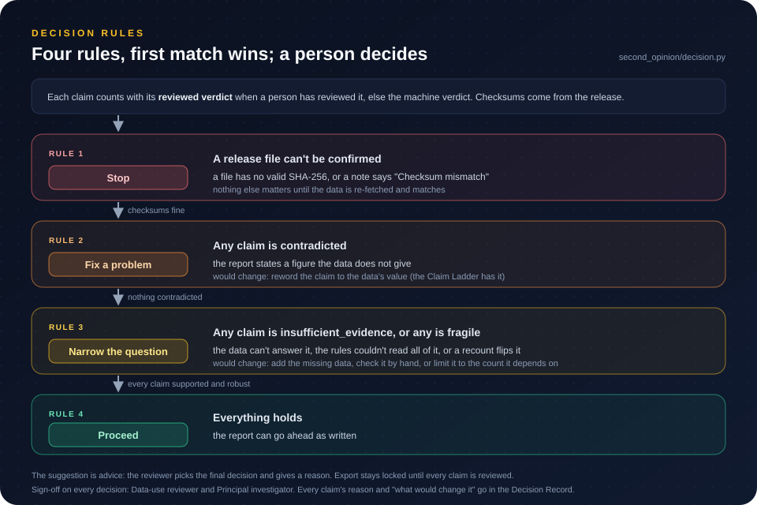

# SecondOpinion architecture

How a report becomes a signed-off audit: the system, the path one claim takes, the decision rules, and
where each rule lives in the code. For setup and the screens, see the [full guide](GUIDE.md).

---

## 1. End-to-end system

<p align="center">
  
</p>

| Stage | What it does | Code |
| :--- | :--- | :--- |
| Web app | Next.js 16 App Router on `:3000`. Proxies `/api/*` to the API (`API_ORIGIN`, 180 s proxy timeout for unsealing and the first practice download). The audit lives in the browser tab (`sessionStorage`), so a reload keeps your work. | [`apps/web/`](../apps/web) |
| API | FastAPI on `:8000`, 14 routes, Pydantic models, no session: the browser sends back what each step needs. `SO_RELEASES_ROOT` can confine release folders to one directory. | [`apps/api/app/`](../apps/api/app) |
| CLI | `second-opinion --release … --report …` runs the same engine and writes `audit.json` only if it passes the shared-format checks. | [`second_opinion/cli.py`](../second_opinion/cli.py) |
| 1. Read | Report file to text (PDF via pypdf), sentences, then fixed rules type each claim and parse its numbers, including numbers written as words. | [`report_file.py`](../second_opinion/report_file.py), [`extract.py`](../second_opinion/extract.py), [`numwords.py`](../second_opinion/numwords.py) |
| 2. Gate | The coverage gate: a reading that leaves any stated word unused (a figure, a group, a qualifier) gives no verdict. The claim becomes `UNMAPPED` with the unused words named. | [`coverage.py`](../second_opinion/coverage.py), `gate()` in [`extract.py`](../second_opinion/extract.py) |
| 3. Check | One pandas check per claim type returns a `Fact` (value, numerator, denominator, the code that ran, sample IDs). | [`checks/`](../second_opinion/checks) |
| 4. Judge | Tolerance rules decide `supported` or `contradicted`; see section 2. | [`verdict.py`](../second_opinion/verdict.py) |
| 5. Recount | The same check under all eight ways of counting; robust if the verdict never changes, fragile if it does, with the choice that flips it. | [`robustness.py`](../second_opinion/robustness.py), [`variants.py`](../second_opinion/variants.py) |
| 6. Skeptic | For comparisons: a label-shuffle p-value (200 shuffles, fixed seed) and leave-one-tissue-site-out. Extra evidence only; never sets a verdict. | [`skeptic.py`](../second_opinion/skeptic.py) |
| 7. Ladder | The Claim Ladder strikes over-strong wording and writes the supported version. Fixed rules, same output every time. | [`ladder.py`](../second_opinion/ladder.py) |
| Review | Accept or override every verdict (an override needs a reason and a role). Four role views come from YAML. | [`roles.yaml`](../second_opinion/roles.yaml), [`apps/web/src/components/review/`](../apps/web/src/components/review) |
| Decision | Suggested by four rules (section 3); a person chooses. | [`decision.py`](../second_opinion/decision.py) |
| Export | `audit.json` in the organizers' shared findings format v0.2, plus `decision_record.md`. Refused until every claim is reviewed. | [`export.py`](../second_opinion/export.py) |

**Data.** A release is a plain folder: `clinical.tsv`, `survival.tsv`, `mutation_gene_level.tsv.gz`,
`copy_number_gistic.tsv.gz` and `protein_rppa.tsv.gz`, plus `rna_hiseq.tsv.gz` when present (envelope releases have
none). Every file's SHA-256 is computed and shown with the evidence. There is no database and nothing is written back.
The organizers' challenge repository is bundled in [`oncosys-hackathon-challenge/`](../oncosys-hackathon-challenge)
(its TCGA data is not committed: `fetch.py` downloads it), and the app runs its own `envelopes/unseal.py` to open a
judges' envelope ([`envelope.py`](../second_opinion/envelope.py)). The practice run finds release A in
`SO_RELEASE_DIR`, then the bundled folder, then downloads it to a temporary folder
([`practice.py`](../second_opinion/practice.py)).

**AI helper (optional, off by default).** Any OpenAI-compatible chat endpoint, configured in `.env`. It never sees a
data value, never states a number and never sets a verdict; section 5 lists what it sees and what checks its answers.

---

## 2. How one claim is read and checked

<p align="center">
  
</p>

Rules run first and own every claim they can read; the AI helper only gets claims the rules could not map, and a
rules verdict is never overridden ([`_audit_one` in `audit.py`](../second_opinion/audit.py)). A sentence with several
checks is audited part by part and takes its worst part's verdict. A check that fails on an unusual release turns
only that claim into `insufficient_evidence`.

Where the tolerances come from:

| Rule | Value | Source |
| :--- | :--- | :--- |
| Exact figure | equal after rounding to the report's own precision | [`verdict.py`](../second_opinion/verdict.py) |
| "About" a share | within 2 percentage points | `PERCENT_TOLERANCE_POINTS` |
| "About" a count | within 2% of the count | `COUNT_TOLERANCE_FRACTION` |
| Ratio ("about two to one" / "twice as many") | within 15% / 10% of the stated ratio | `RATIO_TOLERANCE_FRACTION`, `RATIO_TOLERANCE_EXACT` |
| "About 58 years" (median or mean age) | within 1 year | `AGE_TOLERANCE_YEARS` |
| "Most", "the majority" / "a minority" | more than 50% / under 50% | `WORD_AMOUNTS` in [`extract.py`](../second_opinion/extract.py) |
| "Nearly all" / "the vast majority" | at least 90% / at least 80% | `WORD_AMOUNTS` |
| Close call on a ranking | the top two differ by under 2 percentage points | `CLOSE_RANK_POINTS` in [`audit.py`](../second_opinion/audit.py) |
| Close call on "about" | the gap is 0.75× to 1.5× the tolerance | `_close_call_notes` in `audit.py` |

The full list of claim types and wording rules is in the guide's
[How a verdict is decided](GUIDE.md#how-a-verdict-is-decided).

---

## 3. Decision rules

<p align="center">
  
</p>

Each rule also writes, per claim, what would change the outcome ("If C2 were reworded to 49.9% (421 of 844), it could
be published"). The chosen decision changes the report shown under the Decision screen: *Fix a problem* and *Narrow the
question* write in the Claim Ladder wording, *Stop* marks failing claims *Hold*, *Proceed* keeps the report as written.

---

## 4. The eight ways of counting

Three choices, two options each ([`variants.py`](../second_opinion/variants.py)). The first option of each is the
organizers' reference definition and always gives the primary number; the others only decide robust or fragile.

| Choice | Primary | Alternative |
| :--- | :--- | :--- |
| Subtype label | `PAM50Call_RNAseq` (RNA-seq call) | `PAM50_mRNA_nature2012` (2012 study label) |
| Sex | everyone | women only |
| Samples | primary tumors (by barcode) | all samples |

Receptor status and stage also switch source under the alternative subtype label: clinical IHC columns by default,
the 2012 study's columns otherwise ([`checks/attributes.py`](../second_opinion/checks/attributes.py)).

---

## 5. What the AI helper sees and what checks it

Off unless `SO_AI_API_KEY` and `SO_AI_MODEL` are set; `SO_AI=off` overrides. Every failure falls back to the
rules-only result. The client uses the standard library only and never logs the key or the request body
([`ai/client.py`](../second_opinion/ai/client.py)).

| Use | The model sees | Our code checks | Code |
| :--- | :--- | :--- | :--- |
| Find missed claims | sentences the rules skipped | it may only return indices of sentences we already hold | [`ai/extract_ai.py`](../second_opinion/ai/extract_ai.py) |
| Split a half-read sentence | the sentence and the one before it | each span is copied from the sentence, each figure quoted from its span, and together they cover every figure | [`ai/split.py`](../second_opinion/ai/split.py) |
| Plan a check | the sentence and a schema summary (field names, legal category names, protein rows), never a sample ID or count | whitelisted operations and fields only; the claim must be in the sentence; the coverage gate; filters map to pandas through lookup tables, never `eval` | [`ai/planner.py`](../second_opinion/ai/planner.py), [`ai/plan.py`](../second_opinion/ai/plan.py), [`ai/executor.py`](../second_opinion/ai/executor.py) |
| Review-page wording | the view name and, per claim, its id, final verdict, solidity in words, whether it was overridden, the sentence and the names of its number slots | no digit, number word or comparison outside a `{slot}`, no unknown slot, no name not in the claim's text, length limits; the browser fills the slots from the audit | [`ai/narrate.py`](../second_opinion/ai/narrate.py) |

---

## 6. Code map

```text
apps/web/                       Next.js App Router, TypeScript, Tailwind CSS (design notes in apps/web/DESIGN.md)
apps/api/app/                   FastAPI transport and request/response models (stateless)
second_opinion/                 Python audit engine and CLI, shared by the API and the CLI
second_opinion/checks/          One check per claim type
second_opinion/ai/              Optional AI helper: client, config, plan schema, planner, executor, split, narrate
tests/                          Engine, API and web-flow tests; tests/reports and tests/ai_hard hold reports with known answers
tests/blind/                    Blind sets written before the tool saw them, and their scorer
oncosys-hackathon-challenge/    The organizers' challenge repository (bundled; TCGA data fetched, not committed)
docs/challenge/                 A selected snapshot of the challenge spec, findings format and validator
scripts/py.mjs                  Runs the .venv Python for the npm scripts on macOS, Linux and Windows
```

| Engine module | Role |
| :--- | :--- |
| `report_file.py` | Read an uploaded report: Markdown and text decoded, PDF text pulled out and cleaned |
| `extract.py`, `numwords.py`, `unanswerable.py` | Sentences, claim typing and number parsing (digits and words), "the data can't answer this" |
| `coverage.py` | What a sentence states versus what a reading used; the coverage gate |
| `release.py` | Load a release folder (release A or any envelope), checksums, which samples are in which data layer |
| `checks/` | `count`, `coverage`, `share`, `compare` (protein means), `agreement` (RNA call vs 2012 label), `attribute` (rank, ratio, statistic, group shares); `attributes.py` reads receptor status, stage, histology, mutations, copy number and deaths the same way for every check |
| `verdict.py`, `robustness.py`, `variants.py`, `skeptic.py` | Tolerance rules, the eight ways of counting, label-shuffle and leave-one-site-out |
| `ladder.py` | The Claim Ladder |
| `audit.py` | Runs every claim through the stages above and returns the audit result |
| `decision.py`, `export.py`, `roles.py` | Suggested decision, `audit.json` and Decision Record, role views |
| `practice.py`, `envelope.py` | Find or download release A for the practice run; open a sealed envelope with the organizers' `unseal.py` |
| `model.py`, `cli.py` | Shared data types; the command line |
| `ai/` | The optional AI helper (section 5) |

| API route | Purpose |
| :--- | :--- |
| `POST /report-file` | A report file (Markdown, text or PDF) to its text, for the report box |
| `POST /extract` | Report text to sentences and claims (`split: false` skips the AI split) |
| `POST /classify` | Type one sentence the reviewer ticked |
| `POST /audit` | Claims + release folder to the audit result |
| `POST /practice-release` | A release-A folder for the practice run (local copy or temporary download) |
| `POST /envelope/unseal` | Open a judges' envelope (number + four words) with the organizers' `unseal.py` |
| `POST /decision` | The suggested decision |
| `POST /export` | `audit.json` and the Decision Record (refused until every claim is reviewed) |
| `GET /roles`, `POST /roles` | List roles; add a role |
| `GET /ai/status` | Whether the AI helper is on, its model and host, or why it is off (never the key) |
| `POST /ai/narrate` | AI wording for a role view with blanks for the numbers; always answers 200 (AI text or `template`) |
| `GET /health`, `GET /variants` | Status; the eight ways of counting |

Interactive API docs while the app runs: <http://localhost:3000/api/docs>.

| Screen | Route |
| :--- | :--- |
| Landing page | `/` |
| Start: upload or paste a report, pick a release, practice run, open an envelope | `/start` |
| Claims: untick or add sentences | `/claims` |
| Audit board, evidence for one claim, the report with claims marked | `/board`, `/board/[claimId]`, `/board/report` |
| Review | `/review` |
| Decision and export | `/decision` |
| Storyboard of a whole audit | `/demo` |
